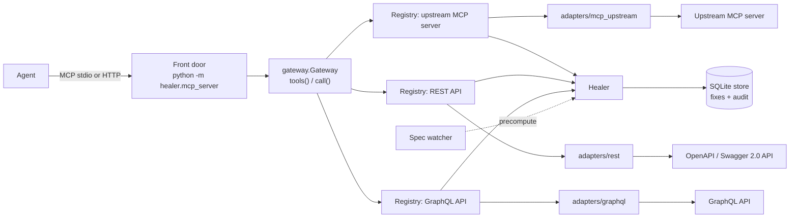
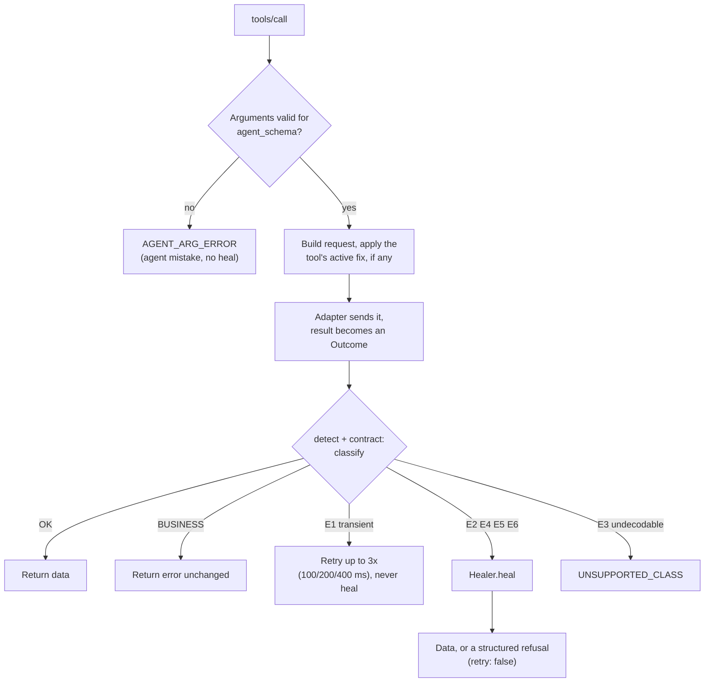
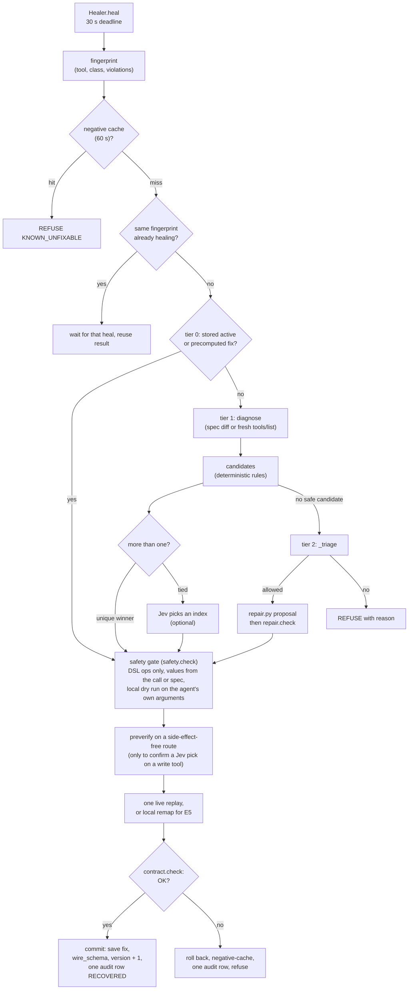
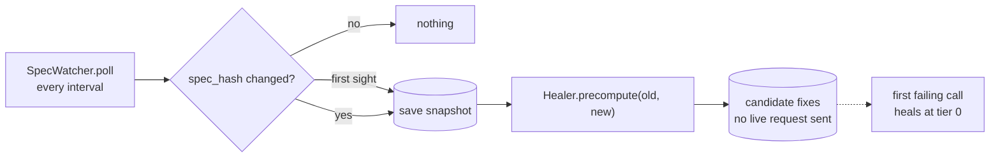
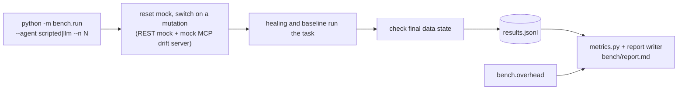

# How it works

An agent calls tools that were generated once from a spec. The services behind them keep changing. This gateway sits between the two: when a call breaks because the service changed shape, it works out the change, rewrites the call using a few safe operations, checks the answer, and logs one audit row. When no safe fix exists, it refuses with a structured error. Requirements: [`product.md`](product.md). Measured results: [`bench/report.md`](bench/report.md). Design detail and limits: [`writeup.md`](writeup.md).

## 1. The big picture

For a local all-services start on Linux/macOS, run `.venv/bin/python start.py`
from the repository root. From elsewhere, use absolute paths to both the
virtual-environment interpreter and `start.py`; service paths are resolved from
the repository root regardless of the caller's working directory. It loads the
root `.env`, uses the repository as each child's working directory, and starts
the REST mock followed by one unified FastAPI dashboard+MCP process. REST
defaults to `127.0.0.1:8000`; dashboard and MCP share `127.0.0.1:8080` at `/`
and `/mcp`. `--mock-port`, `--port`, `--host` and `--db` override environment
defaults (`MOCK_PORT`, `PORT`, `HOST`, `DB_PATH`); explicit CLI arguments win.
Without a `PORT`, the web bind defaults to `127.0.0.1`; a platform `PORT` with
no `HOST` defaults to `0.0.0.0`. The default root `healer.db`
is shared by gateway and dashboard audit reader. Ctrl+C or SIGTERM stops the
launched children; an unexpected child exit also stops the stack. A port
conflict fails startup without killing existing processes. The launcher starts
no demo agent or benchmark and applies no drift automatically; configured MCP
servers and APIs are loaded by the gateway. Individual dashboard and standalone
`healer.mcp_server` commands remain available. Remote MCP protection is
configured with `MCP_TOKEN_ENV` (the name of a separate secret-manager
environment variable), exact comma-separated `MCP_ALLOWED_HOSTS`, and optional
exact comma-separated `MCP_ALLOWED_ORIGINS`; never put the token value in config.
The dashboard itself remains unauthenticated and needs authenticated TLS ingress
when exposed remotely.

The dashboard's demonstration and mutation controls operate on in-process mock
APIs, not the separately launched REST mock or configured upstream MCP servers.
Sharing the audit database does not merge those dashboard traces with calls
made by external MCP clients.

- The agent sees only the front door. `tools/list` is the frozen `agent_schema` of every tool (upstream tools are named `<server>__<tool>`); `tools/call` goes to `Gateway.call`, which finds the `Registry` that owns the tool. The front door adds no healing logic and never sends `tools/list_changed`.
- Each upstream has its own `Registry`: it holds the tool definitions, validates arguments, and talks to the upstream through an adapter. Every spec loader returns the same `dict[str, OperationSpec]`, so diagnosis does not depend on the protocol.
- Upstreams come from `config/mcp_servers.json` (`--mcp-servers`). Tokens are stored as environment-variable names only.

## 2. One tool call

`Registry.call` is the whole entry point. Classes (`detect.py`, then `contract.py`):

| Class | Meaning |
|---|---|
| `E1` | exception, timeout, `5xx`, `429` (retried, not healed) |
| `BUSINESS` | `409`, a missing record, or a value error on an unchanged spec (`NOT_DRIFT`) |
| `E2` | other `4xx`, or a JSON-RPC invalid-params / unknown-tool error |
| `E3` | non-JSON body |
| `E4` | error flag inside a `2xx` body |
| `E5` | body fails the output schema |
| `E6` | a declared postcheck fails on a `2xx` (silent drift) |

A non-idempotent write is never retried on `E1`. MCP results map onto the same classes in the adapter (`isError` and JSON-RPC codes), so a business `isError` stays `BUSINESS`.

## 3. The heal pipeline

In plain words: look the break up in memory first; if it is new, compare the schema the tool was built from with the one the upstream has now; turn the difference into a fix made only of `move`, `cast`, `enum_map`, `encoding`, `header` and `route` operations (`ops.py`, none can write a literal value); check the fix is safe; try it once; keep it only if the answer passes every check.

- **Tier 0.** `store.get_active(fingerprint)` (or a `candidate` the watcher precomputed) skips diagnosis. A tier-0 failure counts as a loss; two losses retire the fix.
- **Tier 1.** `diagnose.py` diffs the base `OperationSpec` against the current one (also detects a renamed tool). With no spec, error-clue mode uses only the structured error and the agent's arguments. `candidates.py` applies fixed rules, capped at 8. With more than one, a deterministic tie-breaker scores description match, parameter order and type; only if it finds no unique winner does `Healer._choose` ask Jev, which returns an index and a confidence, never values.
- **Safety gate (`safety.py`).** Provenance (every source exists in the arguments, config or spec), lossless casts, operation count, replay rule (`E4`/`E6` replay only for an idempotent tool or with an idempotency key; `E5` is remapped locally), write-tool ambiguity, unknown operations.
- **Verify (`contract.py`).** The whole detection pipeline reruns on the replay; only `OK` counts.
- **Tier 2.** If tier 1 refuses with `NO_CANDIDATE`, `LOW_CONFIDENCE`, `UNSAFE_PATCH` or `VERIFY_FAILED`, `Healer._triage` decides whether the repair agent may try. Without Jev only `NO_CANDIDATE` is tried; with Jev, Jev decides between repair and passing the error through. `NO_SAFE_VALUE` (a required value with no source) never goes to tier 2, nor does a failed replay on a write tool. `repair.py` shows the model argument types and enum values (not values) and accepts only a DSL proposal; `repair.check` rejects unknown operations and enum values absent from the new schema. The proposal then runs through the same gate and live verification.
- **Bounds.** One heal per call, one replay per heal, 30 s deadline (tier 2 has its own 30 s), Jev 1.5 s, negative cache 60 s.
- **Audit.** Exactly one `heal_events` row per attempt, written before the agent sees a result; the raw error is sanitized first.

A refusal returns `{error: "SCHEMA_DRIFT_UNRECOVERABLE", tool, class, fingerprint, reason, retry: false}`. The agent should treat that tool as unavailable and continue.

## 4. Spec watcher and precompute

The front door starts a watcher over its upstream specs. It backs off a failing source (`interval x 2^failures`, capped) without stopping the others, never blocks a call, and never changes `agent_schema`.

## 5. The dashboard (`python -m dashboard`)

| Page / flow | What happens |
|---|---|
| `/` landing | Problem, flow animation, benchmark numbers, entry to the guided tour (`guide.js`, plays through every page, auto-play available) |
| `/live` run | `POST /api/start` runs a healing and a baseline agent side by side against two in-process mock APIs; `GET /api/state` is polled for call cards, "broke here" markers and the cost chart |
| Scenario cards, Send prompt | `POST /api/explore` (`dashboard/explorer.py`) runs an editable prompt under a chosen drift (scripted mutation or a `CUSTOM` one) for both agents |
| Drift buttons | `POST /api/mutation` switches a mutation on the mock; if nothing is running it starts a quick scripted pass so the break is hit and healed. `POST /api/reset` clears it |
| Patch log, Metrics | Read from the audit store: what broke (broken field highlighted), what changed, `heal_ms`, ZTAR and other totals |
| MCP view | `GET /api/mcp` lists exactly the front door's frozen tools and transports |
| Report | `GET /api/report` serves `bench/report.md` |
| `/connections` | Add, test and remove upstream MCP servers and APIs by URL (`/api/connections`); writes `config/mcp_servers.json`; tokens by environment-variable name only; off localhost writes need `CONNECTIONS_TOKEN` |

External connection auth is per connection and secret values come from named
environment variables, never connection config. API-call and spec-fetch auth
are separate; saved config and environment rotation take effect after restart,
while the loaded tool schema remains frozen. Remote dashboard exposure still
needs authenticated TLS ingress; see [`docs/external-connections.md`](docs/external-connections.md)
for operator allowlisting, limitations and credential-handling guidance.

`python -m dashboard.demo` is the same story in a terminal; `python -m demo.mcp_agent` is a scripted (or `--llm`) agent that talks only to the front door while the mock MCP server renames an argument mid-task.

## 6. The benchmark

Per scenario it records completion, the final data state, tier, `heal_ms`, MTTR and tokens, then derives ZTAR, Safe-Refusal Rate, False-Patch Rate and MTTR. It also runs clean runs, tier-0 repeats and an error-only ablation (`spec_mode=off`). Scripted mode makes no LLM call; token figures need `--agent llm`.

## 7. File map

| Path | Role |
|---|---|
| `src/healer/mcp_server.py` | Standalone front door (stdio, Streamable HTTP), starts the watcher |
| `dashboard/unified.py` | Dashboard and MCP front door on one HTTP listener; starts the watcher |
| `gateway.py` | `Gateway`, config loading, `upstream_registry`, `api_registry`, `probe` |
| `registry.py` | `ToolDefinition`, `Registry.call()`, `tools()`, dispatch by protocol |
| `adapters/` | `rest`, `mcp_upstream`, `graphql`, `grpc` (deferred): send and normalize to `Outcome` |
| `openapi_loader.py`, `swagger2.py`, `graphql_loader.py` | Spec loaders returning `OperationSpec` maps |
| `detect.py`, `contract.py`, `retry.py` | Classification, output schema and postchecks, `E1` retries |
| `fingerprint.py`, `canonical.py` | Stable break id, canonical JSON |
| `diagnose.py`, `candidates.py` | Spec diff, candidate fixes and tie-breaker |
| `heal.py` | `Healer`: tiers, triage, commit, precompute, sibling propagation |
| `ops.py`, `safety.py` | Operation interpreter and safety gate |
| `jev.py`, `repair.py` | Optional Jev client; tier-2 repair agent |
| `store.py` | SQLite `FixStore` (fixes, snapshots, audit, negative cache, rules); `store_pg.py` deferred |
| `spec_watcher.py` | Polls specs, snapshots, calls `precompute` |
| `metrics.py`, `models.py`, `settings.py` | Benchmark metrics, records and enums, thresholds |
| `mock_api/` | REST mock with mutations; `mcp_drift_server.py` (control: apply, list, reset mutations); GraphQL and gRPC mocks |
| `agents/` | Healing, baseline and scripted agents |
| `bench/` | `run.py`, `overhead.py`, `record_mcp_fixtures.py`, generated `report.md` |
| `dashboard/`, `demo/` | Web UI, terminal demo, MCP demo agent |
| `start.py` | Local Linux/macOS launcher for the REST mock and unified dashboard/MCP process |
| `config/` | `tools.json` (idempotency, postchecks, header sources), `mcp_servers.json` |

## 8. Safety invariants

1. No invented values: a patched request holds only the agent's arguments, a config reference, or a route from the current spec.
2. No model-generated code is executed; fixes are operation lists validated against the operations schema.
3. No loops: one heal per call, one replay per heal, a failed fix is not retried.
4. One audit row per heal attempt, written before the result is returned.
5. Only machine-readable data is stored; secrets never are (header ops store config keys).
6. `agent_schema` is frozen after load; only `wire_schema`, `active_fix_id` and `version` change.
7. No LLM in tiers 0 and 1 except the optional Jev choice; the tier-2 model only proposes gated operations.
8. Fixes are computed from the base schema, never stacked.
9. Error text and descriptions are untrusted data, never a source of values or operations.
10. False-Patch Rate stays 0: a healed result must pass the output schema and postchecks.
