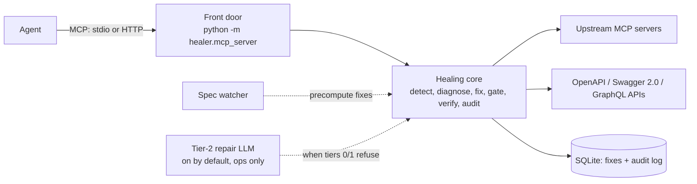

# Self-Healing Gateway for MCP and REST Tools

**An agent calls one MCP server. When an upstream tool or API changes shape underneath it, the gateway repairs the call instead of letting the agent loop on the error.**

Agents call tools that were generated once from a spec or a `tools/list`, and upstreams keep changing. The gateway sits in front of upstream MCP servers and web APIs (OpenAPI 3, Swagger 2.0, GraphQL). On a break it diffs the current schema against the original, builds a fix from a few operations that cannot write an invented value, retries once, checks the answer and writes one audit row. When no safe fix exists it returns a structured refusal (`retry: false`) and the agent skips that one tool.

Built for **PS 01: Self-Healing Tool Registries Under Runtime API Schema Drift**.



Tier 0 replays a stored fix; tier 1 builds one with code; tier 2 (on by default when `NVIDIA_API_KEY` is set, same model as the agents: `LLM_MODEL`, default gpt-oss-20b on NVIDIA NIM; `--no-repair` turns it off) asks an LLM for DSL operations only, which pass the same safety gate and live verification. Details: [`FLOW.md`](FLOW.md).

## Measured

Scripted mode (fixed calls, no LLM), N = 3, from [`bench/report.md`](bench/report.md): the REST mock completed 21/21 healable runs (baseline 3/21), the MCP drift server completed 12/12 (baseline 0/12), and no healed run ended with wrong data (REST 0/24, MCP 0/12). **LLM-mode numbers (token cost, tier 2) are not measured yet.**

## Quick start

**Needs:** Python 3.11+. No API key is needed for the scripted demo, dashboard and benchmark.

1. Create a virtual environment and install everything:

   ```bash
   python -m venv .venv && source .venv/bin/activate
   ```

   ```bash
   pip install -e ".[dev,agents]"
   ```

2. Copy the example settings. The dashboard loads `.env` at startup; put `NVIDIA_API_KEY` there for live agents. Jev is optional (`JEV_API_KEY` / `JEV_URL` / `JEV_MODEL`, or an `OPENROUTER_API_KEY` fallback).

   ```bash
   cp .env.example .env
   ```

3. Pick what to run:

   | I want to… | Command |
   |---|---|
   | See the live dashboard | `python -m dashboard` → open http://127.0.0.1:8080 |
   | Watch a terminal demo (no browser) | `python -m dashboard.demo` |
   | Re-run the benchmark | `python -m bench.run --agent scripted --n 3` |
   | Serve the gateway over MCP (needs `pip install -e ".[mcp]"`) | `python -m healer.mcp_server`, see [`docs/mcp-clients.md`](docs/mcp-clients.md) |
   | Front your own upstreams (MCP servers and APIs) | `python -m healer.mcp_server --mcp-servers config/mcp_servers.json` (tier 2 is on when `NVIDIA_API_KEY` is set; `--no-repair` to turn it off) |
   | Run the MCP demo agent (no key; `--llm` for a live agent) | `python -m demo.mcp_agent` |
   | Run the mock API alone / the tests | `python -m mock_api` (http://127.0.0.1:8000/docs) / `pytest -q` |

**Dashboard** (`python -m dashboard`): `/` landing page with a guided tour, `/live` demo, patch log, metrics, MCP view, report, and `/connections` to add MCP servers and APIs by URL (tokens by environment-variable name only). Page-by-page flows: [`FLOW.md`](FLOW.md).

**Real LLM agents** use NVIDIA NIM (`https://integrate.api.nvidia.com/v1`), default [`openai/gpt-oss-20b`](https://build.nvidia.com/openai/gpt-oss-20b), temperature 0; `LLM_MODEL` overrides it. The dashboard loads `.env`; benchmark and pytest do not, so export the key in the shell:

```bash
export NVIDIA_API_KEY='<your NIM key>'
RUN_E2E=1 .venv/bin/python -m pytest tests/e2e -q
.venv/bin/python -m bench.run --agent llm --n 10
```

**Deploying the dashboard:** one long-running, single-instance process (run state is in memory). Use the `Dockerfile` (Railway via `railway.json`, Fly.io, Cloud Run, Spaces) or `requirements.txt` + `Procfile`. Start: `python -m dashboard` (binds `0.0.0.0:$PORT` when `PORT` is set, else `127.0.0.1:8080`). Optional: `DB_PATH` for a volume.

## Docs

| Document | What's in it |
|---|---|
| [`FLOW.md`](FLOW.md) | How it works end to end, with diagrams and a file map |
| [`writeup.md`](writeup.md) | Design, safety, evaluation, limits, references |
| [`pitch.md`](pitch.md) | Spoken pitch and Q&A |
| [`docs/mcp-clients.md`](docs/mcp-clients.md) | Connect Claude Desktop, Cursor or Windsurf; add an upstream server |
| [`bench/report.md`](bench/report.md) | Full benchmark tables (the only source of numbers) |
| [`product.md`](product.md) | Requirements and acceptance criteria |
| [`plan.md`](plan.md), [`AGENTS.md`](AGENTS.md), [`agent.md`](agent.md) | Status and next steps, contracts and working rules, coding invariants |
