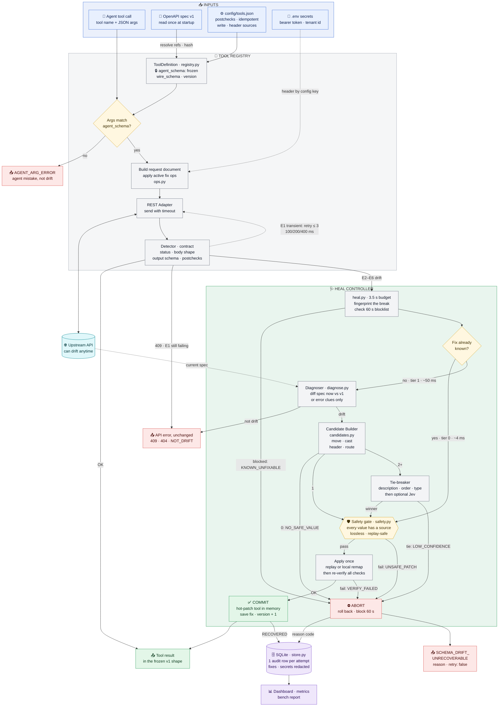
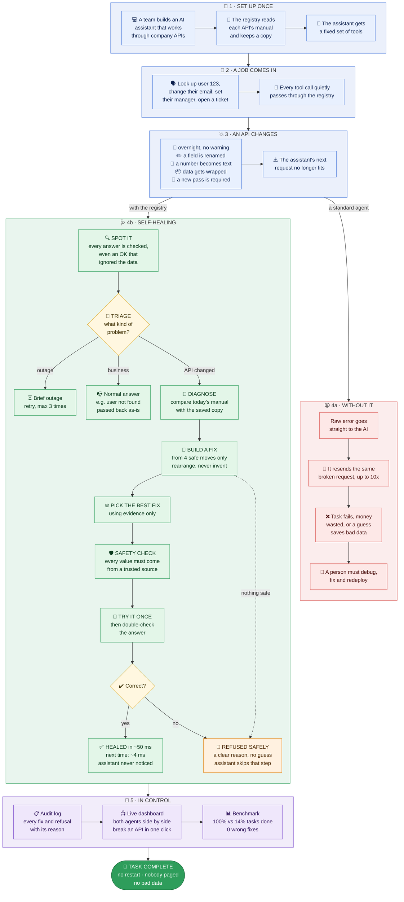

# 🩺 Self-Healing Tool Registry

**When an API changes under your AI agent, the agent keeps working.**

AI agents call APIs through "tools" that are generated once from the API's spec. APIs keep changing; the tools don't. One renamed field and the agent is stuck in a retry loop, or worse, it guesses a value and writes bad data.

This project puts a **registry** between the agent and the API. When a call breaks, the registry figures out what changed, builds a small, provably safe fix, tries it once, checks the answer and hands the result back. The agent never notices. When no safe fix exists, the registry says so and the agent moves on with the rest of its task.

> Built for **PS 01: Self-Healing Tool Registries Under Runtime API Schema Drift**.

---

## ⚡ At a glance

| | Self-healing agent | Standard agent (baseline) |
|---|---|---|
| Tasks completed after the API changed | **100%** (21/21) | 14% (3/21) |
| Wrong data written by a fix | **0** (0/24 heals) | n/a |
| Refused safely when no safe fix existed | **100%** (6/6) | never refuses, loops until the cap |
| Time to heal a new break (median / p95) | **49 ms / 66 ms** | stuck until 10-call cap |
| Time to heal a break it has seen before | **4 ms / 8 ms** | stuck again |

<sub>Source: [`bench/report.md`](bench/report.md), scripted mode (fixed tool calls, no LLM), N = 3 per scenario, 2026-10-14. Timings are wall-clock on a laptop. LLM token overhead has not been measured yet; it needs a run with `--agent llm`.</sub>

---

## 🧠 The idea in 30 seconds

1. **The agent's view never changes.** Each tool keeps the shape it had on day one (`agent_schema`, frozen). The registry translates to whatever the API wants today (`wire_schema`).
2. **Every reply is checked.** Not just the status code: the body is checked against the expected schema, and declared "postchecks" catch an API that says `200 OK` but silently ignored the data.
3. **Fixes are built by code, not by an AI.** The registry diffs today's OpenAPI spec against the original and builds a fix from just four operations: `move`, `cast`, `header`, `route`. **None of them can write a made-up value.**
4. **Prove it before trusting it.** Safety gate → one replay → full re-check. Only then is the fix kept.
5. **Remember it.** The next identical break is fixed from memory in a few milliseconds.
6. **Refuse honestly.** No safe fix? Return a clear error with `retry: false`. The agent skips that one tool and finishes everything else.

---

## 🏗️ Diagram 1: Technical architecture and request lifecycle

How a single tool call flows through the system, which inputs feed each stage, and every output the system can produce.



<details>
<summary><b>How to read Diagram 1</b> (click to expand)</summary>

| Step | What happens | Where in the code |
|---|---|---|
| **Inputs** | The v1 spec becomes the frozen tool schema the agent sees. `tools.json` says which tools write, which are safe to replay, and what to check on every answer. Secrets are referenced by **config key**, never copied into fixes. | `openapi_loader.py`, `registry.py`, `config/tools.json` |
| **Call** | Args are validated against the frozen schema, turned into a request document (`route`, `body`, `query`, `header`), patched by the active fix if any, then sent. | `registry.py`, `ops.py`, `adapters/rest.py` |
| **Detect** | Every reply is sorted into one class (table below). A `200` can still be drift. | `detect.py`, `contract.py` |
| **Heal** | Fingerprint → skip known-unfixable breaks → reuse a stored fix (tier 0) or diagnose (tier 1) → build candidates → break ties by evidence (Jev only as a last resort) → safety gate → replay once → re-verify → commit or abort. | `heal.py`, `fingerprint.py`, `diagnose.py`, `candidates.py`, `jev.py`, `safety.py` |
| **Outputs** | The agent gets either its normal result or one structured error with `retry: false`. Every heal attempt leaves exactly one audit row. | `store.py`, `metrics.py`, `dashboard/` |

**Detection classes (checked in this order)**

| # | What the API did | Class | What the registry does |
|---|---|---|---|
| 1 | Timeout, `5xx`, `429` | `E1` | Retry up to 3 times. Never healed. |
| 2 | `409` conflict | `BUSINESS` | Pass through unchanged. |
| 3 | Other `4xx` (e.g. `422`, `401`) | `E2` | Heal the request. Value-only errors on an unchanged spec → `NOT_DRIFT`. |
| 4 | Body is not JSON | `E3` | Refuse: `UNSUPPORTED_CLASS`. |
| 5 | `2xx` with an error flag inside | `E4` | Heal the request (replay only if safe to repeat). |
| 6 | `2xx` body doesn't match the expected shape | `E5` | Remap the received body locally. No resend. |
| 7 | `2xx` but a postcheck fails (data silently ignored) | `E6` | Heal the request (replay only if safe to repeat). |

**The four fix operations (and why they can't invent data)**

| Op | Does | Where the value comes from |
|---|---|---|
| `move` | Rename, nest or un-nest a field | A value that already exists in the agent's args or the response |
| `cast` | Change a type, e.g. `"123"` → `123` | The same value, only if it round-trips losslessly |
| `header` | Add a required header | A config key such as `OAUTH_BEARER`, never the secret itself |
| `route` | Change method or path | A route that exists in the current spec |

</details>

---

## 🌍 Diagram 2: The end-to-end story (no tech background needed)

What a working day looks like for an AI assistant, with and without the self-healing registry.



---

## 🛡️ Why you can trust it

These are hard rules in the code, not guidelines:

- **Never invents a value.** Every value in a patched request comes from the agent's own arguments, a config key or the live API spec.
- **Never runs AI-written code.** A fix is a list of the four operations above, checked by a pure interpreter.
- **Never loops.** One heal attempt per call, one replay per heal. A fingerprint that failed is blocked for 60 s.
- **Never fixes what isn't broken.** "User not found" and "invalid email" are real answers, not drift. They go back to the agent untouched.
- **Never double-writes.** A request the server may already have executed is only replayed if the tool is idempotent or carries an `Idempotency-Key`.
- **Never heals silently.** Each attempt writes one audit row *before* the agent gets its answer. Secrets are redacted.
- **No AI in the healing path.** Detection, diagnosis and fix building are deterministic code. The only model is **Jev**, an optional non-generative classifier that only picks one of the already-safe candidates, and only when evidence can't break a tie.

---

## 🧪 What we break on purpose

The mock API can switch on each of these changes while an agent is running:

| ID | What changes | Tool | Result |
|---|---|---|---|
| M1 | Field renamed: `user_id` → `customer_id` | `get_user` | ✅ healed with `move` |
| M2 | Type change: `user_id` text → number | `update_email` | ✅ healed with `cast` |
| M3 | Response wrapped in `data: {...}` | `get_user` | ✅ healed by remapping the response |
| M4 | New required `Authorization: Bearer` header | `create_ticket` | ✅ healed with `header` from config |
| M5 | Body nested + type change + new tenant header, all at once | `get_user` | ✅ healed with `move` + `cast` + `header` |
| M6-D | Two fields renamed with no shared words, good descriptions | `set_manager` | ✅ healed by the tie-breaker |
| M6-N | Same, but descriptions are useless | `set_manager` | 🛑 refused `LOW_CONFIDENCE` without Jev (by design: it's a write) |
| M7 | API silently ignores the old `email` field and returns `200` | `update_email` | ✅ caught by a postcheck, healed with `move` |
| M8 | New required `priority` that nobody can supply | `create_ticket` | 🛑 refused `NO_SAFE_VALUE` (correct: guessing would be worse) |
| M9 | Flat request body wrapped in `payload: {...}` | `update_email` | ✅ healed with `move` ×2 |
| C1 | `503` twice, then OK | `get_user` | ↻ retried, not healed |
| C2 | Unknown user returns `404` | `get_user` | ↩ passed through: not drift |
| C3 | Invalid email value, spec unchanged | `update_email` | ↩ passed through: `NOT_DRIFT` |

The dashboard's `POST /api/explore` endpoint also accepts a **custom drift** (rename, type change, body wrapping, required header, required field) on one tool, to try breaks nobody scripted. It is not part of the benchmark numbers.

---

## 🚀 Quick start

**Needs:** Python 3.11+. No API key needed for the scripted demo, dashboard and benchmark.

1. Create a virtual environment and install everything:

   ```bash
   python -m venv .venv && source .venv/bin/activate
   ```

   ```bash
   pip install -e ".[dev,agents]"
   ```

2. Copy the example settings (add `OPENROUTER_API_KEY` only if you want real LLM agents):

   ```bash
   cp .env.example .env
   ```

3. Pick what to run:

   | I want to… | Command |
   |---|---|
   | See the live dashboard | `python -m dashboard` → open http://127.0.0.1:8080 |
   | Watch a terminal demo (no browser) | `python -m dashboard.demo` |
   | Re-run the benchmark | `python -m bench.run --agent scripted --n 3` |
   | Run the mock API on its own | `python -m mock_api` → http://127.0.0.1:8000/docs |
   | Run the tests | `pytest -q` |

**Dashboard pages**

- `/` landing page: the problem, where the registry sits, how drift is detected and patched.
- `/live` both agents side by side. Four one-click presets (Clean, M5, M8, M3), mutation buttons you can press mid-run, a patch log, metrics and the benchmark report. Every tool call opens to show: what the agent sent → the error → what the registry sent instead (header names only) → the final output.

**Using real LLM agents:** set `OPENROUTER_API_KEY` in `.env` (default model `anthropic/claude-haiku-5.5`, change with `LLM_MODEL`), then choose the LLM agent in the dashboard or run `python -m bench.run --agent llm`. Live end-to-end tests run only with `RUN_E2E=1`.

---

## 🗂️ Project layout

```
src/healer/          The registry and healing engine (no LLM calls except jev.py)
  registry.py          Tool definitions, frozen agent_schema, Registry.call()
  adapters/rest.py     Sends the request document over HTTP
  detect.py            Sorts every reply into OK / BUSINESS / E1–E6
  contract.py          Output-schema check and postchecks
  fingerprint.py       Stable id for a break
  diagnose.py          Spec diff and error-clue fallback
  candidates.py        Builds fixes, deterministic tie-breaker
  jev.py               Optional Jev classifier client
  safety.py            Safety gate
  ops.py               Pure interpreter for move / cast / header / route
  heal.py              Heal controller: tiers, deadline, commit / rollback
  store.py             SQLite audit log, fix store, negative cache
  metrics.py           ZTAR, MTTR, refusal and false-patch rates
config/tools.json    Per-tool rules: write, idempotent, postchecks, preverify
mock_api/            FastAPI service that drifts on command (M1–M9, C1–C3, custom)
agents/              Healing and baseline agents (LangGraph or scripted, same prompt)
bench/               Benchmark runner and report.md
dashboard/           Landing page, live side-by-side view, terminal demo
tests/               unit · integration · mock_api · agents · dashboard · e2e
```

---

## ⚠️ Known limits

- Fixes are limited to what `move`, `cast`, `header` and `route` can express. Splitting a field or converting units is refused, not guessed.
- Silent drift (M7-style) is only caught on tools that declare postchecks in `config/tools.json`.
- Without the live spec (error-clue mode), simple changes M1–M4 still heal; nested or combined ones (M5, M9) are refused.
- A non-JSON reply (`E3`) is refused, not healed.
- Fixes are stored in SQLite, so they are shared within one host only.
- LLM token overhead has not been measured yet (the recorded benchmark is scripted).

---

## 📚 Go deeper

| Document | What's in it |
|---|---|
| [`product.md`](product.md) | What we build: requirements, mutation catalog, acceptance criteria |
| [`technical-approach.md`](technical-approach.md) | How it's built: components, data model, algorithms |
| [`writeup.md`](writeup.md) | Design rationale for detection, diagnosis and safe patching |
| [`bench/report.md`](bench/report.md) | Full benchmark tables, including the error-only ablation |
| [`pitch.md`](pitch.md) | 30-second pitch and Q&A cheat sheet |
| [`plan.md`](plan.md) | Build phases and task lists |
| [`agent.md`](agent.md) | Rules for AI coding agents working in this repo |
