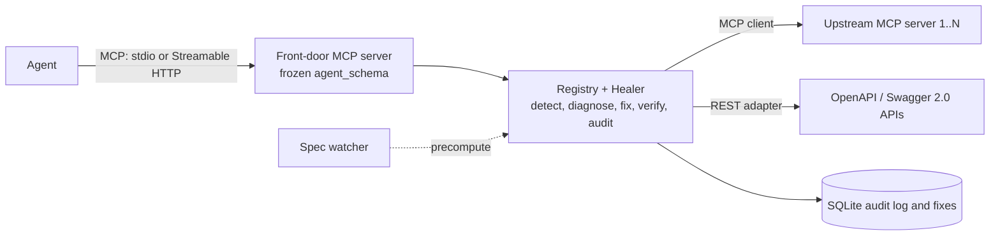

# Self-Healing Gateway for MCP and REST Tools

**When an upstream API or MCP server changes under your agent, the call is repaired instead of looping.**

Agents call tools generated once from a spec or a `tools/list`. Upstreams keep changing; the tools do not. This gateway sits between the agent and its upstreams. When a call breaks, it works out what changed, builds a small fix from operations that cannot write an invented value, tries it once, checks the answer and returns the result. When no safe fix exists it returns a structured refusal (`retry: false`) and the agent skips that one tool.

Built for **PS 01: Self-Healing Tool Registries Under Runtime API Schema Drift**.

**Status.** The healing core, REST/OpenAPI path, benchmark and dashboard are built. The MCP front door is built; the upstream MCP client and MCP healing are in progress (see [`plan.md`](plan.md), Phase 13+). GraphQL, gRPC and Postgres are deferred.



## Measured so far

| | Healing agent | Baseline |
|---|---|---|
| Tasks completed after the API changed (M1 to M5, M7, M9) | **100%** (21/21) | 14% (3/21) |
| Wrong data written by a fix | **0** (0/24 heals) | n/a |
| Refused safely when no safe fix existed | **100%** (6/6) | loops until the 10-call cap |
| Heal time, new break (median / p95) | **49 ms / 66 ms** | n/a |
| Heal time, repeated break (median / p95) | **4 ms / 8 ms** | n/a |

<sub>Source: [`bench/report.md`](bench/report.md): REST mock, scripted mode (fixed tool calls, no LLM), N = 3, 2026-10-14, wall-clock on a laptop. Token overhead and MCP-upstream numbers are not measured yet.</sub>

## How it heals

1. **Frozen agent view.** Each tool keeps its day-one `agent_schema`; the registry translates to the current `wire_schema`.
2. **Every reply is checked**: status, output schema and declared postchecks (catches a `200` that ignored the data).
3. **Code builds the fix** from the current-versus-original schema diff, using `move`, `cast`, `header`, `route` (plus `enum_map`, `encoding`). A deterministic tie-breaker picks between equal candidates; the optional Jev classifier is used only if that still ties.
4. **Prove it**: safety gate, one replay, full re-check, then commit or roll back. One audit row per attempt.
5. **Refuse honestly** when no safe value exists.

Hard rules (details in [`agent.md`](agent.md) §2): no invented values, no executed model code, no loops, no unlogged heal, frozen `agent_schema`, no secrets stored. Non-drift errors (409, missing record, invalid value on an unchanged spec) pass through unchanged.

## Quick start

**Needs:** Python 3.11+. No API key is needed for the scripted demo, dashboard and benchmark.

1. Create a virtual environment and install everything:

   ```bash
   python -m venv .venv && source .venv/bin/activate
   ```

   ```bash
   pip install -e ".[dev,agents]"
   ```

2. Copy the example settings. The dashboard loads `.env` at startup; put `NVIDIA_API_KEY` there to run live agents from the dashboard. Jev is optional and uses separate direct `JEV_API_KEY` / `JEV_URL` / `JEV_MODEL` settings, or its own optional `OPENROUTER_API_KEY` fallback.

   ```bash
   cp .env.example .env
   ```

3. Pick what to run:

   | I want to… | Command |
   |---|---|
   | See the live dashboard | `python -m dashboard` → open http://127.0.0.1:8080 |
   | Watch a terminal demo (no browser) | `python -m dashboard.demo` |
   | Re-run the benchmark | `python -m bench.run --agent scripted --n 3` |
   | Run the mock API on its own | `python -m mock_api` → http://127.0.0.1:8000/docs |
   | Serve the gateway over MCP (needs `pip install -e ".[mcp]"`) | `python -m healer.mcp_server`, see [`docs/mcp-clients.md`](docs/mcp-clients.md) |
   | Run the tests | `pytest -q` |

**Dashboard pages:** `/` landing page; `/live` both agents side by side with four presets (Clean, M5, M8, M3), mutation buttons, patch log, metrics and the benchmark report.

**Real LLM agents** use NVIDIA NIM's OpenAI-compatible endpoint (`https://integrate.api.nvidia.com/v1`), default model [`openai/gpt-oss-20b`](https://build.nvidia.com/openai/gpt-oss-20b), temperature 0; `LLM_MODEL` overrides it. The dashboard loads `.env`; benchmark and pytest processes do not, so export the key in the shell for those:

```bash
export NVIDIA_API_KEY='<your NIM key>'
RUN_E2E=1 .venv/bin/python -m pytest tests/e2e -q
.venv/bin/python -m bench.run --agent llm --n 10
```

**Deploying the dashboard:** one long-running process (not serverless), one instance (run state lives in memory). `Dockerfile` (Railway via `railway.json`, Fly.io, Koyeb, Cloud Run, Hugging Face Spaces) or `requirements.txt` + `Procfile` + `.python-version` (Render, Heroku, Koyeb, Railway without Docker). Install: `pip install -r requirements.txt`. Start: `python -m dashboard` (binds `0.0.0.0:$PORT` when the host sets `PORT`, else `127.0.0.1:8080`). Optional env: `OPENROUTER_API_KEY` for LLM agents, `DB_PATH` to keep the store on a volume.

## Docs

| Document | What's in it |
|---|---|
| [`docs/mcp-clients.md`](docs/mcp-clients.md) | Connect Claude Desktop, Cursor or Windsurf to the gateway; add an upstream server |
| [`product.md`](product.md) | Requirements, mutation catalog, acceptance criteria |
| [`technical-approach.md`](technical-approach.md) | Architecture, data model, algorithms, limits |
| [`writeup.md`](writeup.md) | Diagnosis and patch logic, results, limitations |
| [`bench/report.md`](bench/report.md) | Full benchmark tables, including the error-only ablation |
| [`pitch.md`](pitch.md) | 30-second pitch and Q&A |
| [`plan.md`](plan.md), [`AGENTS.md`](AGENTS.md), [`team-prompts.md`](team-prompts.md) | Build plan, file ownership across the four machines, kickoff prompts |
| [`agent.md`](agent.md) | Coding rules and invariants |
