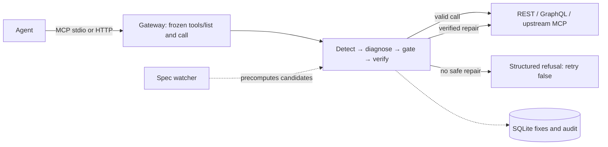

# Self-Healing Tool Registry

**Keep agents working through tool-schema drift—without guessing at missing values or silently changing the tools they were given.** Agents often keep using schemas generated before an API or upstream MCP server changes. This gateway holds the agent-facing schema stable, verifies bounded repairs behind it, and refuses when the available evidence is not enough.



## How it works

The registry loads a tool schema once and exposes that frozen schema to its MCP client. On a drift-like failure, the healer checks for a stored fix, compares the original contract with the current spec or tool list, and builds a candidate from a small set of data-mapping operations. Those operations can only move or transform values already present in the call, configuration, or current spec; they cannot express an invented literal. A candidate is safety-checked, replayed at most once, and retained only when the result passes verification. The attempt is audited.

An optional repair model may propose operations when deterministic diagnosis cannot decide. It receives argument types and enum metadata, not arbitrary raw argument values; its proposal cannot supply values and passes the same safety gate and verification. If a required value is missing, evidence is ambiguous, or verification fails, the gateway returns a structured refusal with `retry: false`. Agents can still see errors by design; they should skip that unavailable tool rather than repeat it. See [`AGENTS.md`](AGENTS.md) for agent-facing contracts and [`PLAN.md`](PLAN.md) for implemented status and remaining work.

## Measured results

The scorecard in [`REPORT.md`](REPORT.md) is dated 2026-10-16: **scripted mode**, fixed calls, no LLM, N=3 per scenario and agent; mock/in-memory measurements, not a production guarantee.

| Measure | REST mock | MCP drift mock |
|---|---:|---:|
| Healable runs completed | 21/21 (baseline 3/21) | 12/12 (baseline 0/12) |
| False patches | 0/24 healed runs | 0/12 healed runs |
| Safe refusals | 6/6 | 6/6 |

Scripted mode's LLM token count is zero because no model call was made; it says nothing about LLM token cost or tier-2 success. Later stress and GitHub-chaos evidence is reported separately with its own date, method, and limitations.

## Quick start

Requires Python 3.11+. From the repository root on Linux/macOS:

```sh
python -m venv .venv
.venv/bin/python -m pip install -e ".[dev,agents,mcp]"
cp .env.example .env  # optional for scripted use; needed for local .env settings
.venv/bin/python start.py
```

The launcher starts the REST mock at `http://127.0.0.1:8000` and a unified dashboard and MCP gateway at `http://127.0.0.1:8080/` and `/mcp`. It loads `.env`, uses `healer.db` in the repository by default, and starts no demo agent, benchmark, or drift automatically. Stop with Ctrl+C. Port conflicts fail startup without stopping the process already using the port. To change ports or database path:

```sh
.venv/bin/python start.py --mock-port 8100 --port 8180 --db /tmp/healer.db
```

`start.py` requires POSIX process groups (Linux/macOS). Services may also be run individually with `python -m dashboard`, `python -m dashboard.demo`, `python -m mock_api`, or `python -m healer.mcp_server` (MCP extra required). The dashboard's guided tour and demo use in-process mocks; they are separate from the standalone REST mock and configured upstreams.

## Demo flow

1. Open `http://127.0.0.1:8080/` and follow the guided tour, or open `/live` to compare the healing and baseline agents against mock drift.
2. Observe the failed call, the verified repair (or refusal), and the audit/metrics views. Dashboard mutation controls affect only their in-process demo mocks.
3. For an external MCP client, connect to `http://127.0.0.1:8080/mcp`; the tool schema stays frozen while the gateway reads the changed upstream contract. The built-in dashboard traces are not merged with external-client call traces.

<details>
<summary>Optional two-machine Prism orders demo</summary>

This demo uses a static mock, not an order database: it always returns the illustrative `ORD-1001` response and keeps no state. Prism 5.14.2 behavior and local registry query-rename recovery were checked; Antigravity UI behavior and two-machine networking were not verified. Only expose Prism on a private demo network, allow inbound TCP/4010 from that network, and do not use Prism's `--errors` option (it may turn the intended 422 into a 500).

**Machine A (API mock):** from the repository root, serve v1:

```sh
npx --yes @stoplight/prism-cli@5.14.2 mock -h 0.0.0.0 -p 4010 demo/prism/openapi-v1.json
```

From Machine B, substitute Machine A's private `PRISM_LAN_IP`; v1 accepts `order_id`, while `order_reference` is rejected:

```sh
curl -sS http://PRISM_LAN_IP:4010/openapi.json
curl -i 'http://PRISM_LAN_IP:4010/orders?order_id=ORD-1001'
curl -i 'http://PRISM_LAN_IP:4010/orders?order_reference=ORD-1001'
```

**Machine B (gateway):** add this object to the existing `apis` array in `config/mcp_servers.json` (merge, do not replace other connections). For this private HTTP endpoint, allow only its exact origin for the demo:

```json
{
  "name": "orders",
  "kind": "openapi",
  "base_url": "http://PRISM_LAN_IP:4010",
  "spec_url": "http://PRISM_LAN_IP:4010/openapi.json",
  "selected_operations": ["get_order"],
  "auth": {"type": "none"}
}
```

```sh
export CONNECTIONS_ALLOWED_ORIGINS=http://PRISM_LAN_IP:4010
.venv/bin/python start.py --port 8080
```

Connect the MCP client to `http://127.0.0.1:8080/mcp` while Prism serves v1. For an Antigravity setup, merge `{"healer":{"serverUrl":"http://127.0.0.1:8080/mcp"}}` into its existing `mcpServers` object using its raw-config UI; no config path is assumed. Ask for `ORD-1001` with `orders__get_order`.

**Drift and reset:** stop Prism on Machine A and serve v2 on the same address:

```sh
npx --yes @stoplight/prism-cli@5.14.2 mock -h 0.0.0.0 -p 4010 demo/prism/openapi-v2.json
```

V2 changes the parameter to `order_reference`; without restarting the gateway or reconnecting the MCP client, repeat the same lookup. To reset, stop Prism, serve `openapi-v1.json` again, then restart the gateway and reconnect/reload the client to establish a fresh v1 baseline. The API spec's inline `/openapi.json` example must remain synchronized when editing the spec.

</details>

## MCP client setup

The gateway supports MCP stdio and Streamable HTTP. Install the MCP extra (`pip install -e ".[mcp]"`). Use the absolute interpreter path—`/ABS/PATH/TO/REPO/.venv/bin/python` on Linux/macOS or `/ABS/PATH/TO/REPO\.venv\Scripts\python.exe` on Windows. Keep stdout reserved for MCP protocol traffic. Merge this full entry (do not overwrite existing servers) into Claude Desktop's local `claude_desktop_config.json`, Cursor's project `.cursor/mcp.json`, or Windsurf's `~/.codeium/windsurf/mcp_config.json`:

```json
{
  "mcpServers": {
    "healer": {
      "command": "/ABS/PATH/TO/REPO/.venv/bin/python",
      "args": ["-m", "healer.mcp_server", "--base-url", "http://127.0.0.1:8000", "--spec-path", "/openapi.json", "--tools", "/ABS/PATH/TO/REPO/config/tools.json", "--db", "/ABS/PATH/TO/REPO/healer.db"]
    }
  }
}
```

For a local Streamable HTTP server, run `.venv/bin/python -m healer.mcp_server --transport http --base-url http://127.0.0.1:8000 --tools /ABS/PATH/TO/REPO/config/tools.json --db /ABS/PATH/TO/REPO/healer.db`; the endpoint defaults to `http://127.0.0.1:8001/mcp`. Cursor's full config is `{"mcpServers":{"healer":{"url":"http://127.0.0.1:8001/mcp"}}}`; Windsurf's is `{"mcpServers":{"healer":{"serverUrl":"http://127.0.0.1:8001/mcp"}}}`. Configurations match server options; manual client-UI verification is outstanding. No `healer-mcp` console command is declared; use `python -m healer.mcp_server` (a console-script entry is pending approval).

Remote HTTP MCP should sit behind trusted TLS ingress, require a non-empty secret-managed bearer token, and allow only exact request hostnames and (if used) exact origins. Bearer auth does not encrypt traffic. Never put token values in client configs, source control, or logs. A hosted Claude connector cannot reach your machine's `localhost`; do not assume it supports the same fixed bearer-header configuration.

To use an inbound token, put its value in a secret manager/environment variable named `HEALER_MCP_TOKEN`, then pass only the **variable name** to the server with `--token-env HEALER_MCP_TOKEN` (or `MCP_TOKEN_ENV=HEALER_MCP_TOKEN` for `start.py`). Configure the client's Authorization header only via its supported secret facility. Claude remote access is through its Connectors/custom connector UI; local `localhost` is not reachable from a hosted connector, and a fixed bearer-header setup is not claimed to work for every Claude connector. For an opt-in config smoke test, use only a trusted config because commands in it may execute: `RUN_MCP_CLIENT_E2E=1 MCP_CLIENT_CONFIG=/ABS/PATH/TO/trusted-client-config.json MCP_CLIENT_NAME=healer .venv/bin/python -m pytest tests/mcp/test_client_config.py -q`. It makes only the known `get_user` call and no paid model calls.

## Upstream APIs and MCP servers

Connections are configured in `config/mcp_servers.json` or through the dashboard's Connections page. Upstream MCP tool names are exposed as `<server>__<tool>`. API operations are capability-gated: without an explicit `selected_operations`, only read-only REST `GET`/`HEAD` and GraphQL queries are exposed; writes require explicitly selected operation IDs or the explicit `"*"` opt-in. Supported auth profiles are none, bearer, API key, basic, and custom secret headers. Spec-fetch auth is separate from API-call auth; reuse is explicit and same-origin only. Connection capabilities and limits are configuration-dependent, not universal API coverage.

Example API connection object for the `apis` array (the variable names are references, not credentials):

```json
{
  "name": "example",
  "kind": "openapi",
  "base_url": "https://api.example.invalid",
  "spec_url": "https://api.example.invalid/openapi.json",
  "selected_operations": ["getRecord"],
  "auth": {"type": "bearer", "token_env": "API_EXAMPLE_TOKEN"},
  "headers": {"Accept": "application/json"},
  "secret_headers": {"X-Client-Key": "API_EXAMPLE_CLIENT_KEY"}
}
```

Store **environment-variable names**, never secret values, in connection configuration. API-call credentials and spec-fetch credentials are separate; cross-origin credential fallback is not allowed. HTTP clients disable redirects, resolve and pin destinations, reject non-public addresses unless the exact origin is operator-allowlisted, and require HTTPS for credentials unless that origin is explicitly allowlisted. Keep `CONNECTIONS_ALLOWED_ORIGINS` narrowly scoped and use controlled egress as another boundary.

The dashboard's connection editor rejects references to healer-owned secrets. Its default allowed variable-name prefixes are `API_`, `MCP_`, and `CONN_`; an operator can replace the dashboard allowlist with `HEALER_CONNECTION_ENV_ALLOW` (comma-separated names; entries ending in `_` are prefixes, other entries exact names). Keep account credentials distinct, including multiple accounts at one provider. Saved edits and rotated values require a gateway restart.

Saved connection changes and credential rotation take effect after a gateway restart; the loaded registry schema remains frozen until restart. Remote dashboard exposure requires authenticated TLS ingress: dashboard mutation routes are not globally authenticated, and MCP bearer auth does not protect the dashboard. `CONNECTIONS_TOKEN` is not global dashboard authentication.

## Deployment

`Dockerfile` and `Procfile` invoke `python start.py`. Use one worker, no reload, and persistent storage for SQLite (`DB_PATH`). For remote MCP, configure `MCP_TOKEN_ENV` to the **name** of a secret environment variable, `MCP_ALLOWED_HOSTS` as exact hostnames, and optionally `MCP_ALLOWED_ORIGINS` as exact origins; terminate TLS at trusted ingress and protect the upstream listener. When deployment supplies `PORT` without `HOST`, the launcher binds `0.0.0.0`; set `HOST` deliberately. Secure the dashboard separately behind authenticated TLS ingress.

## Limitations

- The measured scorecard is scripted and small-sample, against mocks; LLM-mode cost and repair success are not represented by its zero token counts.
- Healing is bounded: a single heal attempt and at most one replay. Ambiguous mappings, missing values, unsupported changes, or failed verification result in refusal, not an invented patch.
- Remote MCP and API behavior depends on network, upstream schemas, and operator configuration. MCP client examples have not received manual UI verification.
- API discovery is not universal: unsupported serializers or parameter forms may omit operations. OAuth refresh/token storage, arbitrary remote `$ref` loading, hot reload, streaming, and global dashboard authentication are not claimed.
- Live GitHub chaos evidence records no false patch after the fix, but mostly observed safe refusals/timeouts; see [`REPORT.md`](REPORT.md) for test scope and limits.

## Testing and benchmarks

Run the offline suite and linter from the repository root:

```sh
.venv/bin/python -m pytest -q
.venv/bin/python -m ruff check .
```

Run the scripted benchmark (no API key or model calls):

```sh
.venv/bin/python -m bench.run --agent scripted --n 3
```

The default output is root `REPORT.md`; the REST scorecard is regenerated and `results.jsonl` is written under `bench/`. Supplying `--out DIR` writes `REPORT.md` and result files inside `DIR`. The runner preserves text after its supplementary-evidence marker, but replaces the generated scorecard; keep a backup/copy of any unmarked consolidation before regenerating so evidence is not lost.

## File map

| Path | Purpose |
|---|---|
| `src/healer/` | Registry, adapters, detection, diagnosis, safety gate, healing, verification, and audit |
| `dashboard/`, `demo/` | Web dashboard and demos |
| `mock_api/`, `agents/` | Drift mocks and benchmark/demo agents |
| `bench/` | Benchmark harnesses and generated artifacts |
| `config/` | Tool behavior and upstream connection configuration |
| `start.py` | Local POSIX launcher for the mock, dashboard, and MCP gateway |
| [`AGENTS.md`](AGENTS.md), [`PLAN.md`](PLAN.md), [`REPORT.md`](REPORT.md) | Agent guidance, status, and measured/evidence report |
